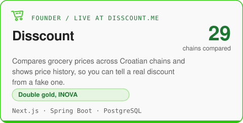
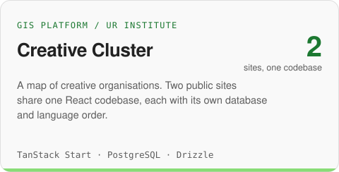
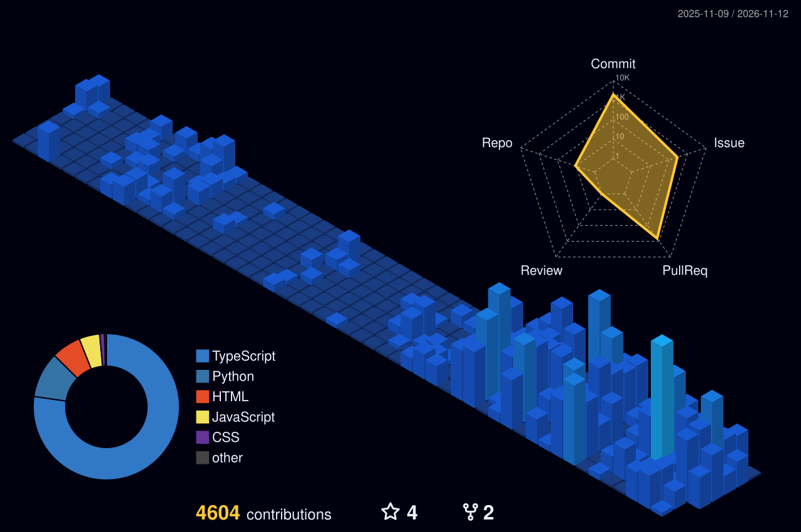

<a href="https://disscount.me"><picture>
  <source media="(prefers-color-scheme: dark)" srcset="./assets/hero-dark.svg">
  
</picture></a>

 

I'm Jakov, a full-stack and DevOps engineer from Croatia. I'm doing an MSc in Computing at FER Zagreb and studying at TU Graz. I founded [Disscount](https://disscount.me), a live grocery price comparison for Croatia that won a double gold at INOVA, and I run it myself, from the Spring Boot API to the Docker deploy.

## Selected work

<a href="https://disscount.me"><picture>
  <source media="(prefers-color-scheme: dark)" srcset="./assets/cards/disscount-dark.svg">
  
</picture></a>

<a href="https://github.com/OffCrazyFreak/Creative-Cluster"><picture>
  <source media="(prefers-color-scheme: dark)" srcset="./assets/cards/creative-cluster-dark.svg">
  
</picture></a>

## Let's talk 

Open to engineering roles in Switzerland, Denmark, Luxembourg, the Netherlands, Austria and Germany.

## Activity

<picture>
  <source media="(prefers-color-scheme: dark)" srcset="./assets/generated/snake-dark.svg">
  
</picture>

